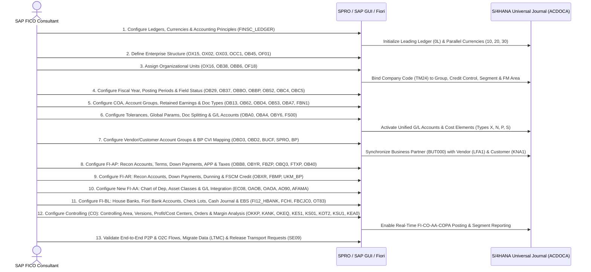

# End-to-End Configuration Of SAP FICO In S/4HANA: Step-by-Step Guide

**SAP FICO (Financial Accounting and Controlling)** in **SAP S/4HANA** forms the core financial backbone of the enterprise, unifying external legal reporting (FI) and internal management accounting (CO) on a single in-memory data architecture. It integrates in real time with **Materials Management (MM)**, **Sales and Distribution (SD)**, and **Production Planning (PP)**.

Below is a complete, production-grade **30-step End-to-End Configuration Guide** structured across the 9 essential S/4HANA FICO modules, complete with **Transaction Codes (T-Codes)**, **SPRO Customizing IMG Paths**, **Topics & Functional Scope**, a **Step-by-Step Configuration Script**, and an **End-to-End Mermaid Sequence Diagram**.

## Module Overview

1. **Introduction to S/4HANA FICO** (Architecture, Universal Journal `ACDOCA`, Parallel Ledgers & Currencies)
2. **Enterprise Structure Configuration** (Company, Company Code, Business Area, Consolidated Business Area, Credit Control Area, FM Area, Segment & Assignments)
3. **General Ledger Accounting (FI-GL)** (Fiscal Year, Posting Periods, Field Status, Chart of Accounts, Account Groups, Retained Earnings, Tolerances, Document Types, Posting Keys, Global Parameters, Document Splitting & `FS00`)
4. **Accounts Payable (FI-AP)** (Vendor Account Groups, Recon Accounts, Payment Terms, Cash Discounts, Down Payments, Automatic Payment Program `FBZP`, Extended Withholding Tax & Input GST/Tax)
5. **Accounts Receivable (FI-AR)** (Customer Account Groups, Recon Accounts, Customer Down Payments, Dunning Procedure `FBMP`, Correspondence & FSCM Credit Management)
6. **Asset Accounting (FI-AA)** (New Asset Accounting Activation, Chart of Depreciation, Depreciation Areas, Account Determination, Asset Classes & Depreciation Keys)
7. **Bank Accounting (FI-BL)** (House Banks in FIORI/NWBC, Check Lots, Cash Journal Setup & Electronic Bank Statement `EBS`)
8. **Business Partner (BP)** (BP Number Ranges, Groupings, BP Roles & Customer/Vendor Integration `CVI` Synchronization)
9. **Controlling (CO) Configuration** (Controlling Area, Document Number Ranges, Plan/Actual Versions, Cost Centers, Secondary Cost Elements, Profit Centers, Internal Orders, Assessments/Distributions & Margin Analysis `CO-PA`)

## 1. Introduction to S/4HANA FICO

In SAP S/4HANA, Financial Accounting (FI) and Controlling (CO) are merged into the **Universal Journal** (Table `ACDOCA`), replacing legacy index and total tables (`GLT0`, `FAGLFLEXT`, `COEP`, `COSP`, `ANEK`, `ANEP`) with a single source of truth.

### Key Architectural Pillars in S/4HANA FICO
- **Universal Journal (`ACDOCA`)**: Combines General Ledger (FI-GL), Asset Accounting (FI-AA), Controlling (CO), Material Ledger (ML), and Margin Analysis (Account-Based CO-PA) line items into a single repository.
- **Unified Master Data (`FS00` & `BP`)**: Cost elements (Primary and Secondary) are maintained directly as G/L Accounts in `FS00` (eliminating `KA01`/`KA06`), and all Customers and Vendors are managed centrally via the **Business Partner (`BP`)** transaction through mandatory Customer/Vendor Integration (CVI).
- **New Asset Accounting (New FI-AA)**: Real-time parallel valuation across multiple Accounting Principles (e.g., IFRS, US GAAP, Local Tax) using Technical Clearing Accounts without periodic reconciliation batch runs.
- **Multi-Currency & Ledger Architecture (`FINSC_LEDGER`)**: Supports Leading Ledger (`0L`), Non-Leading Parallel Ledgers, Extension Ledgers, and up to 8 freely defined additional currencies alongside Company Code (`10`) and Controlling Area (`20`) currencies.

### Step 1: Configure Ledger, Currency Types & Accounting Principles
- **Transaction Code:** `FINSC_LEDGER` / `SPRO`
- **SPRO Path:** `SAP Customizing Implementation Guide -> Financial Accounting -> Financial Accounting Global Settings -> Ledgers -> Ledger -> Define Settings for Ledgers and Currency Types`
- **Topic Covered:** Defines the foundational S/4HANA Universal Journal ledger architecture, sets up Accounting Principles (e.g., `IFRS`, `GAAP`), maps them to Ledger Groups (`0L`), and assigns Company Code and Global Currencies (`10`, `20`, `30`) to the Company Code.
- **Steps:**
  - Execute `SPRO` to define Accounting Principles and assign them to Ledger Group `0L`.
  - Execute `FINSC_LEDGER` and verify Leading Ledger `0L` settings.
  - Under **Currency Types**, confirm Company Code Currency (`10`) and Controlling Area Currency (`20` / `30`).
  - Assign your Company Code (`TM24`) to Ledger `0L`, link the Accounting Principle, and save to a Customizing Transport Request.

## 2. Enterprise Structure Configuration

The Enterprise Structure models your organization's legal entities, business divisions, credit control boundaries, and reporting segments inside SAP S/4HANA.

### Step 2: Define Company (Group Entity)
- **Transaction Code:** `OX15`
- **SPRO Path:** `SAP Customizing Implementation Guide -> Enterprise Structure -> Definition -> Financial Accounting -> Define company`
- **Topic Covered:** Creates the highest organizational unit in Financial Accounting representing a corporate group of companies for consolidated financial statements under commercial law.
- **Steps:**
  - Go to `OX15` and click **New Entries**.
  - Enter a 6-character Company ID (e.g., `TATAGP`), Company Name (`Tata Group`), Street, Postal Code, City (`Pune`), Country (`IN`), Language Key (`EN`), and Group Currency (`INR`).
  - Save the configuration and assign it to a Customizing Request (`F8`).

### Step 3: Define Company Code (Legal Entity)
- **Transaction Code:** `OX02`
- **SPRO Path:** `SAP Customizing Implementation Guide -> Enterprise Structure -> Definition -> Financial Accounting -> Edit, Copy, Delete, Check Company Code`
- **Topic Covered:** Establishes the smallest independent legal accounting unit for which a complete, self-contained set of financial statements (Balance Sheet and Profit & Loss Statement) is drawn up.
- **Steps:**
  - Go to `OX02`, double-click **Edit Company Code Data**, and click **New Entries**.
  - Enter a 4-character Company Code (e.g., `TM24`), Company Name (`Tata Motors`), City (`Pune`), Country (`IN`), Local Currency (`INR`), and Language (`EN`).
  - Click the **Address** icon (`Shift+F5`), complete the full street address, region, and communication details, and save.

### Step 4: Define Business Area, Consolidated Business Area & Segment
- **Transaction Code:** `OX03` (Business Area), `OCC1` (Consolidated Business Area), `SPRO` (Segment)
- **SPRO Path:**
  - Business Area: `SAP Customizing Implementation Guide -> Enterprise Structure -> Definition -> Financial Accounting -> Define Business Area`
  - Consolidated Business Area: `SAP Customizing Implementation Guide -> Enterprise Structure -> Definition -> Financial Accounting -> Maintain consolidation business area`
  - Segment: `SAP Customizing Implementation Guide -> Enterprise Structure -> Definition -> Financial Accounting -> Define Segment`
- **Topic Covered:** Defines cross-company operational divisions (`OX03`), central consolidation business segments (`OCC1`), and IFRS/GAAP-compliant reporting **Segments** (e.g., `TMGS` - Manufacturing) used with Document Splitting and Profit Centers.
- **Steps:**
  - Go to `OX03`, click **New Entries**, and define Business Areas (e.g., `TMMH` Maharashtra, `TMGU` Gujarat).
  - Go to `OCC1`, click **New Entries**, and define Consolidation Business Areas (e.g., `TMWE` West, `TMNT` North).
  - Navigate to **Define Segment** in `SPRO`, click **New Entries**, create Segment `TMGS` (`Manufacturing`), and save.

### Step 5: Define Credit Control Area & Financial Management (FM) Area
- **Transaction Code:** `OB45` (Credit Control Area) & `OF01` (FM Area)
- **SPRO Path:**
  - Credit Control Area: `SAP Customizing Implementation Guide -> Enterprise Structure -> Definition -> Financial Accounting -> Define Credit Control Area`
  - FM Area: `SAP Customizing Implementation Guide -> Enterprise Structure -> Definition -> Financial Accounting -> Maintain FM Area`
- **Topic Covered:** Configures the organizational unit responsible for specifying and monitoring customer credit limits (`OB45`) and the Financial Management Area (`OF01`) for cash budget and funds management.
- **Steps:**
  - Go to `OB45`, click **New Entries**, enter Credit Control Area (`TMCA`), Currency (`INR`), Update Group, Fiscal Year Variant, and Default Credit Limit (`500,000`), then go back one screen to enter the description and save.
  - Go to `OF01`, click **New Entries**, enter FM Area Key (`TMFA`), Description (`FM Area for TM24`), and FM Area Currency (`INR`), then save.

### Step 6: Assign Enterprise Structure Units
- **Transaction Code:** `OX16` (CoCode to Company), `OB38` (CoCode to Credit Control Area), `OBB6` (Business Area to Cons. Business Area), `OF18` (CoCode to FM Area)
- **SPRO Path:** `SAP Customizing Implementation Guide -> Enterprise Structure -> Assignment -> Financial Accounting -> [Assign company code to company / Assign company code to credit control area / Assign business area to consolidation business area / Assign company code to financial management area]`
- **Topic Covered:** Links the legal entity (`TM24`) and operational units to group consolidation (`TATAGP`), credit control (`TMCA`), consolidated business areas (`TMWE`), and funds management (`TMFA`).
- **Steps:**
  - Execute `OX16`: Position to Company Code `TM24` and assign Company `TATAGP`.
  - Execute `OB38`: Position to Company Code `TM24` and assign Credit Control Area `TMCA`.
  - Execute `OBB6`: Assign Business Areas `TMGU` and `TMMH` to Consolidation Business Area `TMWE`.
  - Execute `OF18`: Position to Company Code `TM24`, assign FM Area `TMFA`, and save all assignments.

## 3. General Ledger Accounting (FI-GL)

General Ledger Accounting (`FI-GL`) controls fiscal calendars, posting periods, field statuses, document numbering, tolerance controls, document splitting, and chart of accounts structures.

### Step 7: Maintain Fiscal Year Variant & Assign to Company Code
- **Transaction Code:** `OB29` (Maintain FYV) & `OB37` (Assign FYV)
- **SPRO Path:** `SAP Customizing Implementation Guide -> Financial Accounting -> Financial Accounting Global Settings -> Ledgers -> Fiscal Year and Posting Periods -> Maintain Fiscal Year Variant` / `Assign Company Code to a Fiscal Year Variant`
- **Topic Covered:** Defines the financial reporting calendar structure with 12 normal posting periods and 4 special periods for year-end audit adjustments (e.g., `K4` Jan–Dec or `V3`/`TM` Apr–Mar with year shift `-1` for Jan–Mar).
- **Steps:**
  - Go to `OB29`, click **New Entries** (or copy `V3` to `TM`), set `12` Posting Periods and `4` Special Periods, and define period month/day cutoffs and Period Texts (`APR` to `MAR`, `SP1` to `SP4`).
  - Go to `OB37`, position to Company Code `TM24`, assign Fiscal Year Variant `TM` (or `V3`/`K4`), and save.

### Step 8: Define, Assign & Open/Close Posting Period Variant
- **Transaction Code:** `OBBO` (Define PPV), `OBBP` (Assign PPV), `OB52` (Open/Close Periods)
- **SPRO Path:** `SAP Customizing Implementation Guide -> Financial Accounting -> Financial Accounting Global Settings -> Ledgers -> Fiscal Year and Posting Periods -> Posting Periods -> [Define Variants for Open Posting Periods / Assign Variants to Company Code / Open and Close Posting Periods]`
- **Topic Covered:** Controls which fiscal periods are open or closed for posting across specific account types (`+` Valid for all, `A` Assets, `D` Customers, `K` Vendors, `M` Materials, `S` G/L Accounts) to prevent unauthorized postings in closed periods.
- **Steps:**
  - Execute `OBBO`: Click **New Entries** and define Posting Period Variant `TM24`.
  - Execute `OBBP`: Position to Company Code `TM24` and assign Variant `TM24`.
  - Execute `OB52`: Enter Posting Period Variant `TM24` and maintain Period 1 (`1` to `12`, normal periods) and Period 2 (`13` to `16`, special periods) for Account Types `+`, `A`, `D`, `K`, `M`, and `S`, then save.

### Step 9: Define Field Status Variant & Assign to Company Code
- **Transaction Code:** `OBC4` (Define FSV) & `OBC5` (Assign FSV)
- **SPRO Path:** `SAP Customizing Implementation Guide -> Financial Accounting -> Financial Accounting Global Settings -> Ledgers -> Fields -> Define Field Status Variants` / `Assign Company Code to Field Status Variants`
- **Topic Covered:** Governs line-item screen layout during document entry by setting fields (e.g., Cost Center, Profit Center, Text, Value Date) to **Suppress**, **Required Entry**, or **Optional Entry** across Field Status Groups (`G001` General, `G004` Cost Accounts, `G005` Bank Accounts, `G067` Reconciliation Accounts).
- **Steps:**
  - Go to `OBC4`, select standard variant `0001`, click **Copy As (`F6`)**, rename it to `TM24`, and choose **Copy All**.
  - Double-click **Field status groups** under `TM24` to fine-tune General Data or Additional Account Assignments as required.
  - Go to `OBC5`, position to Company Code `TM24`, assign Field Status Variant `TM24`, and save.

### Step 10: Define Document Types, Number Ranges & Posting Keys
- **Transaction Code:** `OBA7` (Document Types), `FBN1` (Document Number Ranges), `OB41` (Posting Keys)
- **SPRO Path:** `SAP Customizing Implementation Guide -> Financial Accounting -> Financial Accounting Global Settings -> Document -> Document Types -> Define Document Types for Entry View` & `Document Number Ranges -> Define Document Number Ranges` & `Define Posting Keys`
- **Topic Covered:** Differentiates business transactions by Document Type (`SA` G/L Document -> Range `01`, `AA` Asset Posting -> Range `01`, `AF` Depreciation -> Range `04`, `KR` Vendor Invoice -> Range `19`, `KG` Vendor Credit Memo -> Range `17`, `KZ` Vendor Payment -> Range `15`, `DR` Customer Invoice -> Range `18`, `DG` Customer Credit Memo -> Range `16`, `DZ` Customer Payment -> Range `14`) and verifies two-digit Debit/Credit Posting Keys (`40`/`50` G/L, `01`/`15` Customer, `25`/`31` Vendor, `70`/`75` Asset).
- **Steps:**
  - Execute `OBA7`, double-click Document Types (`SA`, `KR`, `KZ`, `DR`, `DZ`, `AA`, `AF`) to verify their assigned Number Range keys and allowed Account Types.
  - Click **Number range information** (or execute `FBN1`), enter Company Code `TM24`, click **Change Intervals**, and insert non-overlapping number intervals for the current fiscal year.
  - Execute `OB41` to verify standard SAP Posting Keys (SAP best practice recommends using standard posting keys without creating custom ones).

### Step 11: Define Chart of Accounts, Account Groups & Retained Earnings Account
- **Transaction Code:** `OB13` (Define COA), `OB62` (Assign COA), `OBD4` (Account Groups), `OB53` (Retained Earnings)
- **SPRO Path:** `SAP Customizing Implementation Guide -> Financial Accounting -> General Ledger Accounting -> Master Data -> G/L Accounts -> Preparations -> [Edit Chart of Accounts List / Assign Company Code to Chart of Accounts / Define Account Group / Define Retained Earnings Account]`
- **Topic Covered:** Establishes the Operational Chart of Accounts (`OB13`), binds it to the Company Code (`OB62`), segments G/L number ranges by Account Group (`OBD4`: Share Capital `SCPL`, Reserves `RSPL`, Current Liabilities `CLPL`, Fixed Assets `FAST`, Current Assets `CAST`, Sales `SALE`, Raw Material `RMCL`, Personnel `PRSN`, Admin `ADMN`, Depreciation `DEPR`), and maps the P&L carryforward Retained Earnings account (`OB53`).
- **Steps:**
  - Execute `OB13`: Click **New Entries**, create Chart of Accounts `TM24`, set Maintenance Language `EN`, and set G/L Account Number Length to `6` digits (ensure **Blocked** is unchecked).
  - Execute `OB62`: Position to Company Code `TM24` and assign Chart of Accounts `TM24`.
  - Execute `OBD4`: Click **New Entries** and define Account Groups under Chart of Accounts `TM24` (e.g., Liabilities `100000–199999`, Assets `200000–299999`, Income `300000–399999`, Expenses `400000–499999`).
  - Execute `OB53`: Enter Chart of Accounts `TM24`, input P&L Statement Type `X`, and assign Retained Earnings G/L Account `100100`.

### Step 12: Define Tolerance Groups, Company Code Global Parameters & Document Splitting
- **Transaction Code:** `OBA0` (G/L Tolerances), `OBA4` (Employee Tolerances), `OBY6` (Global Parameters), `SPRO` (Document Splitting)
- **SPRO Path:**
  - Tolerances: `SAP Customizing Implementation Guide -> Financial Accounting -> General Ledger Accounting -> Business Transactions -> Open Item Clearing -> Clearing Differences -> Define Tolerance Groups for G/L Accounts` / `Define Tolerance Groups for Employees`
  - Global Parameters: `SAP Customizing Implementation Guide -> Financial Accounting -> Financial Accounting Global Settings -> Global Parameters for Company Code -> Enter Global Parameters`
  - Document Splitting: `SAP Customizing Implementation Guide -> Financial Accounting -> General Ledger Accounting -> Business Transactions -> Document Splitting -> Activate Document Splitting`
- **Topic Covered:** Sets maximum posting amounts and clearing difference thresholds (`OBA0`, `OBA4`), consolidates global company code settings (`OBY6`), and activates **Document Splitting** to automatically split line items by **Profit Center** and **Segment** for balanced segment reporting.
- **Steps:**
  - Execute `OBA0`: Create a blank Default Tolerance Group for Company Code `TM24` with permitted debit/credit clearing differences.
  - Execute `OBA4`: Click **New Entries** for Company Code `TM24` and specify maximum Amount per Document, Amount per Open Item, and Cash Discount per Line Item.
  - Execute `OBY6`: Select Company Code `TM24`, verify COA, FYV, FSV, check **Propose Fiscal Year** and **Define Default Value Date**, and save.
  - In `SPRO` under **Document Splitting**, classify G/L Accounts for Document Splitting, verify splitting characteristics (`PRCTR` Profit Center, `SEGMENT` Segment) as Mandatory/Zero-Balance, and activate Document Splitting.

### Step 13: Create G/L Accounts & Cost Elements Centrally
- **Transaction Code:** `FS00`
- **SPRO Path:** `SAP Customizing Implementation Guide -> Financial Accounting -> General Ledger Accounting -> Master Data -> G/L Accounts -> G/L Account Creation and Processing -> Edit G/L Account (Individual Processing) -> Edit G/L Accounts Centrally`
- **Topic Covered:** Creates operational G/L master records in S/4HANA using the unified G/L Account Type model: `X` (Balance Sheet Account), `N` (Non-Operating Expense or Income), `P` (Primary Costs or Revenue), and `S` (Secondary Costs).
- **Steps:**
  - Execute `FS00`, enter G/L Account Number (e.g., `100100` Retained Earnings, `200100` Main Bank, `300000` Sales Revenue, `400100` Salaries), enter Company Code `TM24`, and click **Create**.
  - On **Type/Description**, select the G/L Account Type (`X`, `N`, `P`, or `S`), Account Group, and Short/Long Text (for type `P` or `S`, assign Cost Element Category `1` Primary Cost, `11` Revenue, or `42` Assessment).
  - On **Control Data**, set Account Currency (`INR`), check **Balances in Local Crcy Only** (for Balance Sheet non-reconciliation accounts), and enter Sort Key (`001`).
  - On **Create/Bank/Interest**, assign Field Status Group (`G001` or `G004`) and save.
  - Verify posting readiness via end-user transactions `FB50` / `F-02` (Post), `FB02` (Change), `FB03` (Display), `FAGLL03` / `FAGLB03` (Display Balances), `F-65` (Park), and `FB08` / `F.80` (Individual / Mass Reversal).

## 4. Accounts Payable (FI-AP)

Accounts Payable (`FI-AP`) governs vendor sub-ledger accounting, payment terms, cash discounts, vendor down payments, automatic payment runs (`F110`), withholding taxes, and purchase tax/GST.

### Step 14: Define Vendor Account Groups, Number Ranges & Tolerance Groups
- **Transaction Code:** `OBD3` (Vendor Account Groups), `XKN1` (Vendor Number Ranges), `OBAS` (Assign Number Ranges), `OBA3` (Vendor/Customer Tolerances)
- **SPRO Path:** `SAP Customizing Implementation Guide -> Financial Accounting -> Accounts Receivable and Accounts Payable -> Vendor Accounts -> Master Data -> Preparations for Creating Vendor Master Data -> [Define Account Groups with Screen Layout (Vendors) / Create Number Ranges for Vendor Accounts / Assign Number Ranges to Vendor Account Groups]`
- **Topic Covered:** Defines Vendor Account Groups (e.g., Domestic, Foreign, One-Time Vendors), sets field status layouts for Vendor master views, assigns internal/external number ranges, and configures vendor payment difference tolerances (`OBA3`).
- **Steps:**
  - Execute `OBD3`: Click **New Entries** to create Vendor Account Group (e.g., `TMVN` Domestic Vendors) and configure General/Company Code screen layouts.
  - Execute `XKN1`: Click **Change Intervals** to create a Vendor Number Range interval (or check External if BP drives numbering).
  - Execute `OBAS`: Assign the Number Range key to Vendor Account Group `TMVN`.
  - Execute `OBA3`: Define Customer/Vendor Tolerance Group for Company Code `TM24` to handle payment differences and cash discount terms.

### Step 15: Configure Vendor Reconciliation Account, Payment Terms & Cash Discount Accounts
- **Transaction Code:** `FS00` (Recon G/L), `OBB8` (Payment Terms), `OBXU` (Cash Discount Taken), `OBYR` (Down Payment Alternative Recon Account)
- **SPRO Path:** `SAP Customizing Implementation Guide -> Financial Accounting -> Accounts Receivable and Accounts Payable -> Business Transactions -> Outgoing Invoices/Credit Memos -> Maintain Terms of Payment` / `Define Accounts for Cash Discount Taken` & `Down Payment Made -> Define Alternative Reconciliation Account for Down Payments`
- **Topic Covered:** Creates the Accounts Payable sub-ledger Reconciliation Account (`FS00` with Recon Account Type `K`), defines payment terms and discount rules (`OBB8`), maps automatic G/L posting for cash discounts taken from vendors (`OBXU`), and links the Special G/L Indicator `A` for Vendor Down Payments (`OBYR`).
- **Steps:**
  - Execute `FS00`: Create Accounts Payable Reconciliation G/L Account (Balance Sheet `X`, Recon Account for Account Type `K` Vendors, Field Status `G067`) and an Advance to Vendor G/L Account under Current Assets.
  - Execute `OBB8`: Click **New Entries** to create Payment Terms (e.g., `TM01` - 2% discount within 10 days, Net 30 days) with Baseline Date set to Posting Date.
  - Execute `OBXU`: Enter Chart of Accounts `TM24` and assign the Cash Discount Received G/L Account for transaction key `SKE`.
  - Execute `OBYR`: Double-click Special G/L Indicator `A` (Down Payment), enter Chart of Accounts `TM24`, and link the Vendor Recon Account to the Alternative Vendor Advance G/L Account (enabling down payment posting `F-48`, invoice `FB60`/`F-43`, down payment clearing `F-54`, and outgoing payment/clearing `F-53`/`F-44`).

### Step 16: Configure Automatic Payment Program (APP)
- **Transaction Code:** `FBZP` (Configuration) & `F110` (Execution)
- **SPRO Path:** `SAP Customizing Implementation Guide -> Financial Accounting -> Accounts Receivable and Accounts Payable -> Business Transactions -> Outgoing Payments -> Automatic Outgoing Payments -> Payment Method/Bank Selection for Payment Program`
- **Topic Covered:** Configures the six sequential tabs of the Automatic Payment Program (`FBZP`) to automate mass vendor/customer disbursements via Check, Wire Transfer, ACH, or SEPA/ISO20022 XML (`F110`).
- **Steps:**
  - Execute `FBZP` and configure all 6 buttons sequentially:
    1. **All Company Codes**: Set Sending and Paying Company Code (`TM24`), cash discount tolerances, and Special G/L indicators to be paid (`A`, `F`).
    2. **Paying Company Codes**: Specify minimum incoming/outgoing payment amounts and payment advice forms.
    3. **Payment Methods in Country**: Select Country (`IN`/`US`) and define Payment Methods (e.g., `C` Check, `T` Bank Transfer) and Payment Medium Workbench (PMW) format.
    4. **Payment Methods in Company Code**: Set minimum/maximum payment limits per method and bank optimization rules for `TM24`.
    5. **Bank Determination**: Select `TM24` and configure **Ranking Order**, **Bank Accounts (Enhanced)**, **Available Amounts**, and **Value Dates**.
    6. **House Banks**: Verify linked House Bank IDs.

### Step 17: Configure Tax on Sales/Purchases (GST/VAT) & Extended Withholding Tax (WHT)
- **Transaction Code:** `OBQ2` (Access Sequence), `OBQ1` (Condition Types), `OBCN` (Process Keys), `OBQ3` (Tax Procedure), `OBBG` (Assign Country), `FTXP` (Tax Codes), `OB40` (Tax G/L Accounts), `OBCL` (Non-Taxable Code), `SPRO` (Extended WHT)
- **SPRO Path:**
  - Tax/GST: `SAP Customizing Implementation Guide -> Financial Accounting -> Financial Accounting Global Settings -> Tax on Sales/Purchases -> Basic Settings -> [Check Calculation Procedure / Assign Country to Calculation Procedure]` & `Calculation -> Define Tax Codes for Sales and Purchases` & `Posting -> Define Tax Accounts`
  - Withholding Tax: `SAP Customizing Implementation Guide -> Financial Accounting -> Financial Accounting Global Settings -> Withholding Tax -> Extended Withholding Tax -> [Calculation / Company Code / Posting]`
- **Topic Covered:** Configures indirect taxes (Input/Output GST or VAT) and direct **Extended Withholding Tax (TDS)** for invoice-time and payment-time tax deductions.
- **Steps:**
  - Verify Access Sequence (`OBQ2`), Condition Types (`OBQ1`), and Accounting Keys (`OBCN`), then define or verify Tax Procedure (`OBQ3`, e.g., `TAXINN`) and assign it to Country (`OBBG`).
  - Create Tax Codes in `FTXP` (e.g., `I1` Input GST, `O1` Output GST), create Input/Output Tax G/L Accounts in `FS00`, assign them in `OB40`, and set default non-taxable codes in `OBCL`.
  - In `SPRO` (**Extended Withholding Tax**), define WHT Countries, Official WHT Keys, WHT Types for Invoice Posting and Payment Posting, WHT Codes, assign WHT Types to Company Code `TM24`, activate Extended WHT, and map WHT Payable G/L Accounts (`OBWW`).

## 5. Accounts Receivable (FI-AR)

Accounts Receivable (`FI-AR`) manages customer billing (`FB70`/`F-22`), incoming payments (`F-28`), customer advances (`F-29`/`F-39`), dunning reminders (`F150`), account statements (`F.64`), and FSCM credit management.

### Step 18: Define Customer Account Groups, Number Ranges & Reconciliation Account
- **Transaction Code:** `OBD2` (Customer Account Groups), `XDN1` (Customer Number Ranges), `OBAR` (Assign Number Ranges), `FS00` (Customer Recon Account)
- **SPRO Path:** `SAP Customizing Implementation Guide -> Financial Accounting -> Accounts Receivable and Accounts Payable -> Customer Accounts -> Master Data -> Preparations for Creating Customer Master Data -> [Define Account Groups with Screen Layout (Customers) / Create Number Ranges for Customer Accounts / Assign Number Ranges to Customer Account Groups]`
- **Topic Covered:** Defines Customer Account Groups (e.g., Domestic, Export, One-Time Customers), assigns customer number ranges, and creates the Accounts Receivable sub-ledger Reconciliation Account (`FS00` with Recon Account Type `D`).
- **Steps:**
  - Execute `OBD2`: Click **New Entries** to define Customer Account Group `TMCU` and set field status rules.
  - Execute `XDN1` and `OBAR`: Create Customer Number Range intervals and assign them to `TMCU`.
  - Execute `FS00`: Create Accounts Receivable Reconciliation G/L Account (Balance Sheet `X`, Recon Account for Account Type `D` Customers, Field Status Group `G067`).

### Step 19: Configure Customer Down Payments & Cash Discount Granted
- **Transaction Code:** `OBXR` (Customer Down Payment Recon) & `OBXI` (Cash Discount Granted)
- **SPRO Path:** `SAP Customizing Implementation Guide -> Financial Accounting -> Accounts Receivable and Accounts Payable -> Business Transactions -> Down Payment Received -> Define Reconciliation Accounts for Customer Down Payments` & `Incoming Payments -> Incoming Payments Global Settings -> Define Accounts for Cash Discount Granted`
- **Topic Covered:** Maps the Special G/L Indicator `A` for advances received from customers (`OBXR`) to an alternative liability reconciliation account and configures automatic G/L determination for cash discounts granted to customers (`OBXI`).
- **Steps:**
  - Create a Customer Advance Received G/L Account under Current Liabilities (`FS00`, Recon Type `D`).
  - Execute `OBXR`: Double-click Special G/L Indicator `A`, enter Chart of Accounts `TM24`, and link the normal Customer Recon Account to the Customer Advance G/L Account (enabling Customer Down Payment `F-29`, Invoice `FB70`/`F-22`, Down Payment Clearing `F-39`, and Open Item Clearing `F-32`).
  - Execute `OBXI`: Enter Chart of Accounts `TM24` and assign the Cash Discount Allowed Expense G/L Account (`SKT`).

### Step 20: Configure Dunning Area, Dunning Procedure & Correspondence
- **Transaction Code:** `OB61` (Dunning Area), `FBMP` (Dunning Procedure), `OB78` / `FB12` / `F.64` (Party Statements & Correspondence)
- **SPRO Path:** `SAP Customizing Implementation Guide -> Financial Accounting -> Accounts Receivable and Accounts Payable -> Business Transactions -> Dunning -> Basic Settings for Dunning -> Define Dunning Areas` & `Dunning Procedure -> Define Dunning Procedures`
- **Topic Covered:** Automates multi-tier overdue payment reminder letters (`F150`) and periodic customer/vendor account statements (`FB12` Request / `F.64` Maintain).
- **Steps:**
  - Execute `OB61`: Define Dunning Area for Company Code `TM24` if dunning is tracked by organizational sub-unit.
  - Execute `FBMP`: Click **New Procedure**, enter Dunning Procedure Code (`TMDU`), set Dunning Interval in Days (`10`), Number of Dunning Levels (`4`), and Grace Days.
  - Click **Dunning Levels**, **Charges**, **Minimum Amounts**, and **Dunning Texts** to assign SmartForms/Adobe Forms per level, then save (and assign `TMDU` in the Customer BP Master).
  - Configure Correspondence Types (`SAP06` Account Statement) in `SPRO` so users can request (`FB12`) and print (`F.64`) periodic party statements.

### Step 21: Configure SAP S/4HANA Credit Management (FIN-FSCM-CR)
- **Transaction Code:** `UKM_BP` / `SPRO`
- **SPRO Path:** `SAP Customizing Implementation Guide -> Financial Supply Chain Management -> Credit Management -> Credit Risk Monitoring -> Master Data -> Create Credit Segments`
- **Topic Covered:** Replaces legacy FI-AR credit control (`FD32`) with **SAP Credit Management (`FIN-FSCM-CR`)**, enabling automated credit scoring, risk classes, credit segments, and real-time SD/FI credit exposure checks via BP role `UKM000`.
- **Steps:**
  - In `SPRO` under **Financial Supply Chain Management -> Credit Management**, define **Credit Segments** (e.g., `CS_TM24`) and map them to your Credit Control Area (`TMCA`).
  - Define **Rating Procedures**, **Risk Classes**, and **Credit Limit Check Rules**.
  - Maintain customer credit limits and risk categories in transaction `UKM_BP` under Business Partner Role `UKM000` (SAP Credit Management).

## 6. Asset Accounting (FI-AA)

In S/4HANA, **New Asset Accounting (New FI-AA)** posts asset acquisitions, retirements, and depreciation directly to the Universal Journal (`ACDOCA`) in real time across all valuation ledgers.

### Step 22: Copy Reference Chart of Depreciation, Define Depreciation Areas & Assign
- **Transaction Code:** `EC08` (Copy Chart of Depreciation), `OADB` (Depreciation Areas), `OAOB` (Assign to Company Code)
- **SPRO Path:** `SAP Customizing Implementation Guide -> Financial Accounting -> Asset Accounting -> Organizational Structures -> Copy Reference Chart of Depreciation/Depreciation Areas` & `Assign Chart of Depreciation to Company Code`
- **Topic Covered:** Establishes the country-specific asset valuation structure (`EC08`), configures parallel Depreciation Areas (`01` Book Depreciation, `15` Tax Depreciation, `32` IFRS Group Valuation) mapped to Accounting Principles (`OADB`), and assigns the Chart of Depreciation to the Company Code (`OAOB`).
- **Steps:**
  - Execute `EC08`: Copy the country reference Chart of Depreciation (e.g., `0IN` or `0US`) to `TMCD`, then specify description and delete unneeded depreciation areas.
  - Execute `OADB`: Verify that each active Depreciation Area is assigned to the corresponding Ledger Group and Accounting Principle, and define how each area posts to the G/L (`1` Area Posts in Real Time).
  - Execute `OAOB`: Position to Company Code `TM24`, assign Chart of Depreciation `TMCD`, and save.

### Step 23: Define Account Determination, Screen Layout, Number Ranges & Asset Classes
- **Transaction Code:** `SPRO` (Account Determination & Screen Layout), `AS08` (Asset Number Ranges), `OAOA` (Asset Classes)
- **SPRO Path:** `SAP Customizing Implementation Guide -> Financial Accounting -> Asset Accounting -> Organizational Structures -> Asset Classes -> [Specify Account Determination / Create Screen Layout Rules / Define Number Range Interval / Define Asset Classes]`
- **Topic Covered:** Classifies fixed assets into logical categories (e.g., Land, Buildings, Plant & Machinery, Vehicles, Assets Under Construction `AUC`) and links each Asset Class to its G/L Account Determination key, Screen Layout Rule, and Asset Master Number Range (`AS01`).
- **Steps:**
  - In `SPRO`, execute **Specify Account Determination** and create keys (e.g., `TM_BLDG`, `TM_MACH`, `TM_VEH`).
  - Execute **Create Screen Layout Rules** to copy standard layout rules.
  - Execute `AS08`: Enter Company Code `TM24` and define internal number range intervals (`01`, `02`, `03`).
  - Execute `OAOA`: Click **New Entries** to create Asset Classes, linking each class to its Account Determination key, Screen Layout Rule, and Number Range.

### Step 24: Configure G/L Integration (`AO90`), Technical Clearing Account & Depreciation Keys (`AFAMA`)
- **Transaction Code:** `AO90` (Assign G/L Accounts) & `AFAMA` (Maintain Depreciation Keys)
- **SPRO Path:** `SAP Customizing Implementation Guide -> Financial Accounting -> Asset Accounting -> Integration with General Ledger Accounting -> Assign G/L Accounts` / `Define Technical Clearing Account for Integrated Asset Acquisition` & `Depreciation -> Valuation Methods -> Depreciation Key -> Maintain Depreciation Key`
- **Topic Covered:** Maps Asset Accounting balance sheet and P&L accounts (`AO90`: APC Acquisition Cost, Accumulated Depreciation, Ordinary Depreciation Expense, Gain/Loss on Retirement), configures the mandatory S/4HANA **Technical Clearing Account** for integrated asset acquisitions (`F-90`), and activates Depreciation Keys (`AFAMA`: Straight-Line, Declining-Balance, WDV) for monthly depreciation runs (`AFAB`).
- **Steps:**
  - Create Asset APC, Accumulated Depreciation, Technical Clearing (Recon Type `A`), and Depreciation Expense G/L Accounts in `FS00`.
  - Define the **Technical Clearing Account for Integrated Asset Acquisition** in `SPRO`.
  - Execute `AO90`: Select Chart of Depreciation `TMCD`, double-click **Account Determination**, select each asset class key, and assign Balance Sheet and Depreciation G/L accounts per Depreciation Area.
  - Execute `AFAMA`: Verify and activate Depreciation Keys (e.g., `LINR` Straight-Line, `DG20` Declining Balance) and assign default Useful Lives and Depreciation Keys per Asset Class in `OAYZ`.

## 7. Bank Accounting (FI-BL)

Bank Accounting (`FI-BL`) governs house bank master data, check lot management, petty cash journals, and automated Electronic Bank Statement (`EBS`) reconciliation.

### Step 25: Define House Banks, Bank Accounts & Check Lots
- **Transaction Code:** `FI12_HBANK` / `FI12` (House Banks), `NWBC` / Fiori **Manage Bank Accounts**, `FCHI` (Check Lots)
- **SPRO Path:** `SAP Customizing Implementation Guide -> Financial Accounting -> Bank Accounting -> Bank Accounts -> Define House Banks` & `Business Transactions -> Check Management -> Define Number Ranges for Checks`
- **Topic Covered:** Sets up corporate banking institutions (`FI12_HBANK`), maintains individual bank account numbers and IBANs via Fiori/NWBC Bank Account Management (S/4HANA architecture change), and defines check lot ranges (`FCHI`) for check printing and register tracking (`FCH5` Manual Check, `FCHN` Check Register, `FCH6` Encashment Date, `FCH3` Void Unissued Checks).
- **Steps:**
  - Execute `FI12_HBANK`: Enter Company Code `TM24`, click **New Entries**, and define House Bank ID (e.g., `HDFC1`), Bank Country (`IN`), and Bank Key (`HDFC0000123`).
  - Open Fiori App **Manage Bank Accounts** (or `NWBC`) to create Bank Account ID (`CURR1`), Account Number, Currency (`INR`), and link the Main Bank G/L Account (`200100`).
  - Execute `FCHI`: Enter Paying Company Code `TM24`, House Bank `HDFC1`, Account ID `CURR1`, click **Change**, and create Check Lot `0001` (`100001` to `100500`).

### Step 26: Configure Cash Journal & Electronic Bank Statement (EBS)
- **Transaction Code:** `FBCJC0` (Setup Cash Journal), `FBCJC1` (Number Range), `FBCJC2` (Business Transactions), `OT83` (Configure EBS)
- **SPRO Path:**
  - Cash Journal: `SAP Customizing Implementation Guide -> Financial Accounting -> Bank Accounting -> Business Transactions -> Cash Journal -> [Create G/L Account for Cash Journal / Define Number Range Intervals for Cash Journal Documents / Set Up Cash Journal / Create, Change, Delete Business Transactions]`
  - EBS: `SAP Customizing Implementation Guide -> Financial Accounting -> Bank Accounting -> Business Transactions -> Payment Transactions -> Electronic Bank Statement -> Make Global Settings for Electronic Bank Statement`
- **Topic Covered:** Configures petty cash books (`FBCJ`) for daily cash receipts and expenses and sets up **Electronic Bank Statement (`OT83`)** rules to automatically import and clear MT940, BAI2, or CAMT.053 bank files (`FF_5` / `FEBAN`).
- **Steps:**
  - Create a Petty Cash G/L Account in `FS00`, define Cash Journal number range `01` in `FBCJC1`, set up Cash Journal `CJ01` for Company Code `TM24` in `FBCJC0`, and define Business Transactions (`C` Cash Receipt from Bank, `E` Expense, `R` Revenue) in `FBCJC2` (with print parameters in `FBCJC3`).
  - Execute `OT83` for Electronic Bank Statement:
    1. **Create Account Symbols** (`MAIN_BANK`, `CHQ_OUT`, `CHQ_IN`).
    2. **Assign Accounts to Account Symbols** using masking (`++++++` for Main Bank and Bank Sub-Accounts).
    3. **Create Keys for Posting Rules** and **Define Posting Rules** (linking Debit/Credit posting areas).
    4. **Create Transaction Type** (e.g., `MT940`) and assign External Bank Transaction codes to Posting Rules.

## 8. Business Partner (BP)

In SAP S/4HANA, traditional Customer (`FD01`/`XD01`) and Vendor (`FK01`/`XK01`) transactions are obsolete and redirect to the unified **Business Partner (`BP`)** transaction via **Customer/Vendor Integration (CVI)**.

### Step 27: Define Business Partner Number Ranges, Groupings & BP Roles
- **Transaction Code:** `BUCF` (BP Number Ranges) & `SPRO` (Groupings & BP Roles)
- **SPRO Path:** `SAP Customizing Implementation Guide -> Cross-Application Components -> SAP Business Partner -> Business Partner -> Basic Settings -> Number Ranges and Groupings -> [Define Number Ranges / Define Groupings and Assign Number Ranges]` & `Business Partner Roles -> Define BP Roles`
- **Topic Covered:** Establishes Business Partner number intervals (`BUCF`), links them to BP Groupings (`TMBV` for Vendors, `TMBC` for Customers), and verifies standard S/4HANA BP Roles (`000000` General BP, `FLVN00` FI Vendor, `FLVN01` MM Purchasing Supplier, `FLCU00` FI Customer, `FLCU01` SD Customer, `UKM000` Credit Management).
- **Steps:**
  - Execute `BUCF`, click **Change Intervals**, and define internal/external BP Number Ranges (matching the Vendor `XKN1` and Customer `XDN1` ranges if using Same Number synchronization).
  - Navigate to **Define Groupings and Assign Number Ranges** in `SPRO`, click **New Entries**, and define BP Groupings `TMBV` (Vendor BP) and `TMBC` (Customer BP) linked to their respective number ranges.
  - Verify active Synchronization Objects (`BP`, `CUSTOMER`, `VENDOR`) under Cross-Application Components -> Master Data Synchronization -> Synchronization Control.

### Step 28: Configure Customer/Vendor Integration (CVI) Direction BP to Customer/Vendor
- **Transaction Code:** `SPRO` & `BP` (Master Data Creation)
- **SPRO Path:**
  - Vendor CVI: `SAP Customizing Implementation Guide -> Cross-Application Components -> Master Data Synchronization -> Customer/Vendor Integration -> Business Partner Settings -> Settings for Vendor Integration -> Field Assignment for Vendor Integration -> Assign Keys -> Define Number Assignment for Direction BP to Vendor`
  - Customer CVI: `SAP Customizing Implementation Guide -> Cross-Application Components -> Master Data Synchronization -> Customer/Vendor Integration -> Business Partner Settings -> Settings for Customer Integration -> Field Assignment for Customer Integration -> Assign Keys -> Define Number Assignment for Direction BP to Customer`
- **Topic Covered:** Maps BP Roles and BP Groupings to the underlying FI Customer (`OBD2`) and FI Vendor (`OBD3`) Account Groups so saving a Business Partner in `BP` automatically creates the corresponding records in tables `BUT000`, `LFA1`/`LFB1`, and `KNA1`/`KNB1`.
- **Steps:**
  - In `SPRO` under **Settings for Customer Integration -> Set BP Role Category for Direction BP to Customer**, verify `FLCU00` and `FLCU01`.
  - Under **Define Number Assignment for Direction BP to Customer**, click **New Entries**, link BP Grouping `TMBC` to Customer Account Group `TMCU`, and check **Same Numbers**.
  - In `SPRO` under **Settings for Vendor Integration -> Set BP Role Category for Direction BP to Vendor**, verify `FLVN00` and `FLVN01`.
  - Under **Define Number Assignment for Direction BP to Vendor**, click **New Entries**, link BP Grouping `TMBV` to Vendor Account Group `TMVN`, check **Same Numbers**, and save (test master creation in `BP`).

## 9. Controlling (CO) Configuration

Controlling (`CO`) provides internal managerial accounting across Cost Centers (`CO-OM-CCA`), Internal Orders (`CO-OM-OPA`), Profit Centers (`EC-PCA`), Product Costing (`CO-PC`), and Account-Based Profitability Analysis / Margin Analysis (`CO-PA`).

### Step 29: Maintain Controlling Area, Number Ranges, Plan Versions & Profit Center Settings
- **Transaction Code:** `OKKP` (Maintain Controlling Area), `KANK` (CO Number Ranges), `OKEQ` (Versions), `0KE5` (PCA Controlling Area Settings), `KE59` (Dummy Profit Center), `1KEF` (PCA Actual Data Control), `KCH1`/`KCH4` (Profit Center Hierarchy), `KE51` (Create Profit Center)
- **SPRO Path:** `SAP Customizing Implementation Guide -> Controlling -> General Controlling -> Organization -> [Maintain Controlling Area / Maintain Number Ranges for Controlling Documents / Maintain Versions]` & `Profit Center Accounting -> Basic Settings -> Controlling Area Settings -> Maintain Controlling Area Settings`
- **Topic Covered:** Configures the central Controlling Area (`OKKP`), assigns Company Code `TM24`, defines CO document number ranges (`KANK`), maintains Plan/Actual Version `0` (`OKEQ`), and activates Profit Center Accounting (`0KE5`, `1KEF`, `KCH4`, `KE51`).
- **Steps:**
  - Execute `OKKP`, click **New Entries**, define Controlling Area `TM24`, set **Controlling Area Same as Company Code**, Currency Type `10`, Chart of Accounts `TM24`, Fiscal Year Variant `TM`, and Cost Center Standard Hierarchy `TM24_CC_HIER`.
  - In `OKKP`, double-click **Assignment of Company Code(s)** to assign `TM24`, and double-click **Activate Components/Control Indicators** to activate **Cost Centers**, **Order Management**, **Profit Center Accounting**, and **Profitability Analysis** for the fiscal year.
  - Execute `KANK`: Copy or create CO Document Number Range groups and assign CO business transactions (`COIN`, `RKU1`, `RKU3`, `RKIV`).
  - Execute `OKEQ`: Select Version `0` (Plan/Actual Version), verify Controlling Area Settings and Fiscal Year Parameters, and save.
  - Execute `0KE5`, `KE59`, `1KEF`, `KCH4`, and `KE51` to maintain Profit Center Accounting settings, Standard Hierarchy `TM24_PC_HIER`, and active Profit Centers.

### Step 30: Configure Cost Centers, Internal Orders, Cost Allocations & Margin Analysis (CO-PA)
- **Transaction Code:** `OKEON` (Cost Center Standard Hierarchy), `KS01` (Create Cost Center), `KOT2` (Internal Order Types), `KO01` (Create Internal Order), `KSV1` (Distribution Cycle), `KSU1` (Assessment Cycle), `KEQ3` / `KEA0` (Operating Concern & Margin Analysis)
- **SPRO Path:** `SAP Customizing Implementation Guide -> Controlling -> Cost Center Accounting -> Master Data -> Cost Centers -> Define Standard Hierarchy` & `Internal Orders -> Order Master Data -> Define Order Types` & `Profitability Analysis -> Structures -> Define Operating Concern`
- **Topic Covered:** Completes managerial accounting by establishing Departmental Cost Centers (`KS01`), CAPEX/OPEX Internal Orders (`KOT2`/`KO01`), month-end overhead Distribution (`KSV1`/`KSV5`) and Assessment (`KSU1`/`KSU5`) cycles using Secondary Cost Elements (`FS00` Type `S`, Category `42`), and **Account-Based CO-PA (Margin Analysis)** in `ACDOCA`.
- **Steps:**
  - Execute `KS01`: Create operational Cost Centers (e.g., `CC_PROD`, `CC_ADMIN`, `CC_SALES`), assign Cost Center Category (`F` Production, `A` Admin), Person Responsible, Profit Center, and Hierarchy Area.
  - Execute `KOT2`: Define Internal Order Types (e.g., `ZCAP` Capital Investment Order, `ZOPX` Overhead Marketing Order) with Settlement Profiles (`OKO7`) and Number Ranges (`KONK`), then create orders in `KO01`.
  - Create Secondary Assessment G/L Accounts in `FS00` (Account Type `S` Secondary Costs, Cost Element Category `42` Assessment) and configure month-end Assessment (`KSU1`) and Distribution (`KSV1`) cycles.
  - Execute `KEA0` and `KEQ3` to maintain the Operating Concern, activate **Account-Based Profitability Analysis (Margin Analysis)**, and assign the Controlling Area to the Operating Concern.

## Quick T-Code & SPRO Summary Matrix

| Step | Module | Configuration Activity | T-Code | SPRO IMG Path Summary |
| :--- | :--- | :--- | :--- | :--- |
| **01** | **1. Intro / Ledgers** | Ledger, Currency & Accounting Principles | `FINSC_LEDGER` | FI Global Settings -> Ledgers -> Ledger -> Define Settings for Ledgers |
| **02** | **2. Enterprise Structure** | Define Company (Group) | `OX15` | Enterprise Structure -> Definition -> FI -> Define company |
| **03** | **2. Enterprise Structure** | Define Company Code | `OX02` | Enterprise Structure -> Definition -> FI -> Edit Company Code |
| **04** | **2. Enterprise Structure** | Business Area, Cons. Bus. Area & Segment | `OX03` / `OCC1` | Enterprise Structure -> Definition -> FI -> Business Area & Segment |
| **05** | **2. Enterprise Structure** | Credit Control Area & FM Area | `OB45` / `OF01` | Enterprise Structure -> Definition -> FI -> Credit Control & FM Area |
| **06** | **2. Enterprise Structure** | Assign Enterprise Structure Units | `OX16` / `OB38` / `OBB6` / `OF18` | Enterprise Structure -> Assignment -> Financial Accounting |
| **07** | **3. General Ledger** | Fiscal Year Variant & Assignment | `OB29` / `OB37` | FI Global Settings -> Ledgers -> Fiscal Year and Posting Periods |
| **08** | **3. General Ledger** | Posting Period Variant & Open/Close | `OBBO` / `OBBP` / `OB52` | FI Global Settings -> Ledgers -> Fiscal Year -> Posting Periods |
| **09** | **3. General Ledger** | Field Status Variant & Assignment | `OBC4` / `OBC5` | FI Global Settings -> Ledgers -> Fields -> Field Status Variants |
| **10** | **3. General Ledger** | Document Types, Number Ranges & Keys | `OBA7` / `FBN1` / `OB41` | FI Global Settings -> Document -> Document Types & Number Ranges |
| **11** | **3. General Ledger** | COA, Account Groups & Retained Earnings | `OB13` / `OB62` / `OBD4` / `OB53` | FI -> GL Accounting -> Master Data -> G/L Accounts -> Preparations |
| **12** | **3. General Ledger** | Tolerances, Global Params & Doc Splitting | `OBA0` / `OBA4` / `OBY6` | FI -> GL Accounting -> Business Transactions -> Document Splitting |
| **13** | **3. General Ledger** | Create G/L Accounts & Cost Elements | `FS00` | FI -> GL Accounting -> Master Data -> G/L Accounts -> Centrally |
| **14** | **4. Accounts Payable** | Vendor Account Groups, Ranges & Tolerances | `OBD3` / `XKN1` / `OBAS` / `OBA3` | FI -> AR and AP -> Vendor Accounts -> Master Data -> Preparations |
| **15** | **4. Accounts Payable** | Recon Account, Terms, Discounts & Advances | `FS00` / `OBB8` / `OBXU` / `OBYR` | FI -> AR and AP -> Business Transactions -> Outgoing Invoices & Down Pmt |
| **16** | **4. Accounts Payable** | Automatic Payment Program (APP) | `FBZP` / `F110` | FI -> AR and AP -> Business Transactions -> Automatic Outgoing Payments |
| **17** | **4. Accounts Payable** | GST/VAT Tax Procedure & Extended WHT | `OBQ3` / `OBBG` / `FTXP` / `OB40` | FI Global Settings -> Tax on Sales/Purchases & Extended Withholding Tax |
| **18** | **5. Accounts Receivable** | Customer Account Groups, Ranges & Recon | `OBD2` / `XDN1` / `OBAR` / `FS00` | FI -> AR and AP -> Customer Accounts -> Master Data -> Preparations |
| **19** | **5. Accounts Receivable** | Customer Down Payments & Discounts | `OBXR` / `OBXI` | FI -> AR and AP -> Business Transactions -> Down Payment Received |
| **20** | **5. Accounts Receivable** | Dunning Procedure & Correspondence | `OB61` / `FBMP` / `FB12` / `F.64` | FI -> AR and AP -> Business Transactions -> Dunning -> Dunning Procedure |
| **21** | **5. Accounts Receivable** | S/4HANA Credit Management (FSCM) | `UKM_BP` / `SPRO` | Financial Supply Chain Management -> Credit Management -> Credit Segments |
| **22** | **6. Asset Accounting** | Chart of Depreciation & Depreciation Areas | `EC08` / `OADB` / `OAOB` | FI -> Asset Accounting -> Organizational Structures -> Copy Chart of Dep. |
| **23** | **6. Asset Accounting** | Account Determination & Asset Classes | `AS08` / `OAOA` | FI -> Asset Accounting -> Organizational Structures -> Asset Classes |
| **24** | **6. Asset Accounting** | Asset G/L Integration & Depreciation Keys | `AO90` / `AFAMA` / `OAYZ` | FI -> Asset Accounting -> Integration with General Ledger Accounting |
| **25** | **7. Bank Accounting** | House Banks, Fiori Bank Accts & Check Lots | `FI12_HBANK` / `NWBC` / `FCHI` | FI -> Bank Accounting -> Bank Accounts -> Define House Banks |
| **26** | **7. Bank Accounting** | Cash Journal Setup & Electronic Bank Stmt | `FBCJC0` / `FBCJC2` / `OT83` | FI -> Bank Accounting -> Business Transactions -> Cash Journal & EBS |
| **27** | **8. Business Partner** | BP Number Ranges, Groupings & Roles | `BUCF` / `SPRO` | Cross-Application Components -> SAP Business Partner -> Basic Settings |
| **28** | **8. Business Partner** | Customer/Vendor Integration (CVI Mapping) | `SPRO` / `BP` | Cross-Application Components -> Master Data Synchronization -> CVI |
| **29** | **9. Controlling (CO)** | Controlling Area, Versions & Profit Centers | `OKKP` / `KANK` / `OKEQ` / `KE51` | Controlling -> General Controlling -> Organization -> Controlling Area |
| **30** | **9. Controlling (CO)** | Cost Centers, Internal Orders & CO-PA | `KS01` / `KOT2` / `KSU1` / `KEA0` | Controlling -> Cost Center Accounting / Internal Orders / Margin Analysis |

## Cross-Module Integration, Cutover & Testing Reference

- **FI-MM Integration (`OBYC`)**: Maps Material Management automatic account determination keys (`BSX` Inventory Posting, `WRX` GR/IR Clearing Account, `GBB` Offsetting Entry for Inventory Posting, `PRD` Price Differences) to Valuation Classes and G/L Accounts.
- **FI-SD Integration (`VKOA`)**: Maps Sales and Distribution billing condition types to Revenue G/L Accounts (`ERL`), Sales Deductions/Discounts (`ERS`), and Freight Revenue (`ERF`) via Chart of Accounts, Sales Organization, Account Assignment Group, and Account Key.
- **Cutover & Data Migration (`LTMC` / Fiori Migration Cockpit)**: Migrates G/L Master Data (`FS00`), Business Partners (`BP`), Cost/Profit Centers (`KS01`/`KE51`), Fixed Asset Legacy Data (`AS91` / `ABLDT`), and Open Items for AP, AR, and G/L balances prior to Go-Live.
- **Testing & Transport Lifecycle (`SE09`/`SE10`)**: All SPRO configurations are captured in Customizing Transport Requests in Development (`DEV`), verified through Functional Unit Testing (`FUT`), transported to Quality (`QAS`) for System Integration Testing (`SIT` covering Procure-to-Pay `ME21N -> MIGO -> MIRO -> F110` and Order-to-Cash `VA01 -> VL01N -> VF01 -> F-28`) and User Acceptance Testing (`UAT`), and finally imported into Production (`PRD`).

## Step-by-Step SAP S/4HANA FICO Configuration Script

Below is the rapid-execution configuration script summarizing the transaction codes and sequential actions for an end-to-end SAP S/4HANA FICO implementation.

### 1. Configure Ledgers & Currencies
**Transaction Code:** `FINSC_LEDGER`
**Steps:**
- Go to `FINSC_LEDGER`.
- Select Leading Ledger `0L` and verify Company Code assignment (`TM24`).
- Assign Company Code Currency (`10`), Controlling Area Currency (`20`), and Accounting Principle (`IFRS`).
- Save the configuration.

### 2. Define Company & Company Code
**Transaction Codes:** `OX15` (Company) and `OX02` (Company Code)
**Steps:**
- Go to `OX15`, click **New Entries**, enter Group Company `TATAGP`, Country, and Currency, and save.
- Go to `OX02`, click **New Entries**, enter Company Code `TM24`, Name, City, Country, Currency (`INR`), and Language (`EN`), complete the Address screen, and save.

### 3. Define Business Area, Segment, Credit Control Area & FM Area
**Transaction Codes:** `OX03`, `OCC1`, `OB45`, and `OF01`
**Steps:**
- Go to `OX03` and `OCC1` to create Business Areas (`TMMH`, `TMGU`) and Consolidation Business Areas (`TMWE`).
- Go to `SPRO` (`Define Segment`) and create Segment `TMGS`.
- Go to `OB45` to define Credit Control Area `TMCA` and `OF01` to define FM Area `TMFA`, and save.

### 4. Assign Organizational Units
**Transaction Codes:** `OX16`, `OB38`, `OBB6`, and `OF18`
**Steps:**
- Go to `OX16` and assign Company Code `TM24` to Company `TATAGP`.
- Go to `OB38` and assign Company Code `TM24` to Credit Control Area `TMCA`.
- Go to `OBB6` and assign Business Areas to Consolidation Business Area `TMWE`.
- Go to `OF18` and assign Company Code `TM24` to FM Area `TMFA`, and save.

### 5. Configure Fiscal Year Variant, Posting Period Variant & Field Status Variant
**Transaction Codes:** `OB29`, `OB37`, `OBBO`, `OBBP`, `OB52`, `OBC4`, and `OBC5`
**Steps:**
- Go to `OB29` to define Fiscal Year Variant `TM` (12 periods + 4 special periods) and assign it to `TM24` in `OB37`.
- Go to `OBBO` to define Posting Period Variant `TM24`, assign it in `OBBP`, and open posting periods for `+`, `A`, `D`, `K`, `M`, `S` in `OB52`.
- Go to `OBC4` to copy Field Status Variant `0001` to `TM24` and assign it to Company Code `TM24` in `OBC5`.

### 6. Configure Document Types, Number Ranges, COA, Account Groups & Retained Earnings
**Transaction Codes:** `OBA7`, `FBN1`, `OB13`, `OB62`, `OBD4`, and `OB53`
**Steps:**
- Go to `OBA7` to verify Document Types (`SA`, `KR`, `KZ`, `DR`, `DZ`, `AA`, `AF`) and maintain number intervals in `FBN1`.
- Go to `OB13` to define Chart of Accounts `TM24` and assign it to Company Code `TM24` in `OB62`.
- Go to `OBD4` to define G/L Account Groups and `OB53` to assign Retained Earnings Account `100100`.

### 7. Configure Tolerances, Global Parameters, Document Splitting & Create G/L Accounts
**Transaction Codes:** `OBA0`, `OBA4`, `OBY6`, and `FS00`
**Steps:**
- Go to `OBA0` and `OBA4` to define G/L and Employee Tolerance Groups for `TM24`.
- Go to `OBY6` to verify Company Code Global Parameters and activate Document Splitting in `SPRO`.
- Go to `FS00` to create Balance Sheet (`X`), Non-Operating (`N`), Primary Cost/Revenue (`P`), and Secondary Cost (`S`) G/L Accounts.

### 8. Configure Business Partner (BP) & CVI Synchronization
**Transaction Codes:** `OBD3`, `XKN1`, `OBAS`, `OBD2`, `XDN1`, `OBAR`, `BUCF`, `SPRO`, and `BP`
**Steps:**
- Define Vendor Account Groups (`OBD3`, `XKN1`, `OBAS`) and Customer Account Groups (`OBD2`, `XDN1`, `OBAR`).
- Go to `BUCF` to define BP Number Ranges and create BP Groupings (`TMBV`, `TMBC`) in `SPRO`.
- In `SPRO` under **Customer/Vendor Integration (CVI)**, map `TMBV -> TMVN` and `TMBC -> TMCU` with **Same Numbers** checked, and create Business Partners in `BP`.

### 9. Configure Accounts Payable (FI-AP) & Automatic Payment Program
**Transaction Codes:** `OBB8`, `OBXU`, `OBYR`, `FBZP`, `OBQ3`, `OBBG`, `FTXP`, and `OB40`
**Steps:**
- Go to `OBB8` to maintain Payment Terms, `OBXU` for Cash Discount Taken, and `OBYR` for Vendor Down Payment Alternative Recon Account (`A`).
- Go to `FBZP` and configure All Company Codes, Paying Company Codes, Payment Methods in Country/Company Code, and Bank Determination for `F110`.
- Configure Tax Procedure (`OBQ3`, `OBBG`), Tax Codes (`FTXP`), Tax G/L Determination (`OB40`), and Extended Withholding Tax in `SPRO`.

### 10. Configure Accounts Receivable (FI-AR), Dunning & Credit Management
**Transaction Codes:** `OBXR`, `OBXI`, `OB61`, `FBMP`, and `UKM_BP`
**Steps:**
- Go to `OBXR` to assign Customer Down Payment Recon Account (`A`) and `OBXI` for Cash Discount Granted.
- Go to `OB61` and `FBMP` to configure Dunning Areas and 4-Level Dunning Procedures for `F150`.
- Configure Credit Segments in `SPRO` and maintain Customer Credit Limits in `UKM_BP` (Role `UKM000`).

### 11. Configure New Asset Accounting (FI-AA) & Bank Accounting (FI-BL)
**Transaction Codes:** `EC08`, `OADB`, `OAOB`, `AS08`, `OAOA`, `AO90`, `AFAMA`, `FI12_HBANK`, `FCHI`, `FBCJC0`, and `OT83`
**Steps:**
- Copy Chart of Depreciation in `EC08`, verify Depreciation Areas in `OADB`, and assign to `TM24` in `OAOB`.
- Define Asset Classes (`OAOA`), Asset Number Ranges (`AS08`), G/L Account Determination (`AO90`), and Depreciation Keys (`AFAMA`).
- Define House Banks (`FI12_HBANK`), Bank Accounts in Fiori/NWBC, Check Lots (`FCHI`), Cash Journal (`FBCJC0`), and Electronic Bank Statement (`OT83`).

### 12. Configure Controlling (CO), Cost/Profit Centers, Internal Orders & Margin Analysis
**Transaction Codes:** `OKKP`, `KANK`, `OKEQ`, `0KE5`, `KCH4`, `KE51`, `KS01`, `KOT2`, `KSU1`, and `KEA0`
**Steps:**
- Go to `OKKP` to maintain Controlling Area `TM24`, assign Company Code `TM24`, and activate CO components.
- Maintain CO Document Number Ranges (`KANK`) and Plan/Actual Version `0` (`OKEQ`).
- Create Profit Centers (`KCH4`, `KE51`), Cost Centers (`KS01`), Internal Order Types (`KOT2`), Assessment Cycles (`KSU1`), and activate Account-Based CO-PA (`KEA0`).

## End-to-End SAP S/4HANA FICO Configuration Sequence Diagram

